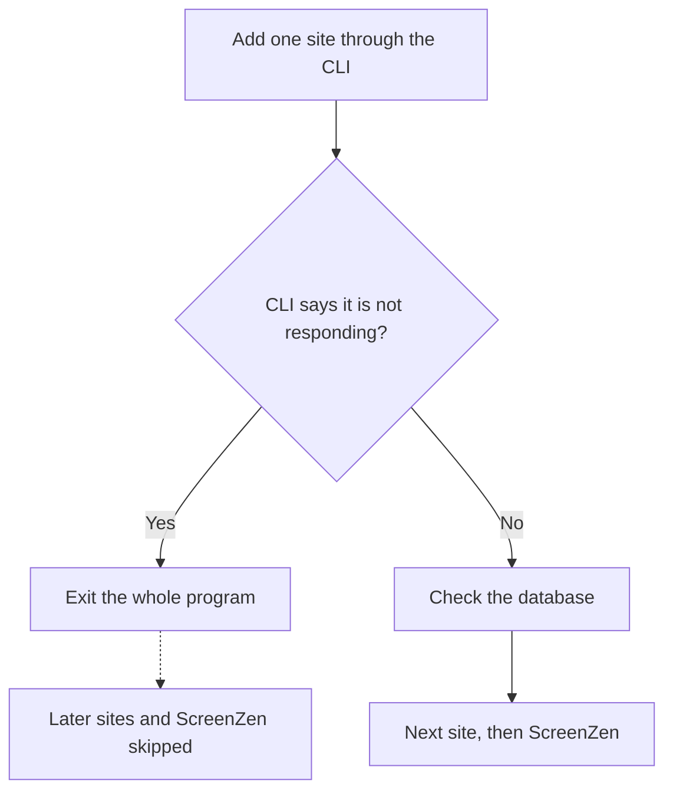
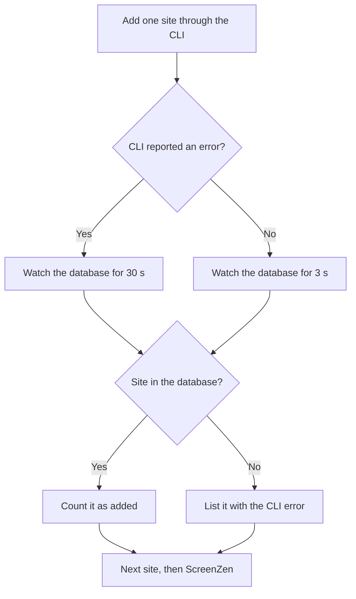

# Focus Sync Failures

`focus sync` stopped at the first Cold Turkey CLI error, whether or not the change had landed. [PR #319](https://github.com/yulonglin/dotfiles/pull/319) fixed that. One site is still missing, because the CLI can also drop a change. Status at 22:18 HST on 4 Nov 2026.

## Sync now finishes, and one site is still missing

- **Fixed:** one CLI error no longer stops the sync. The first real run after the fix reached every mode and ScreenZen.
- **Not fixed:** `alignment.anthropic.com` is not in the admin block. The CLI said "isn't responding" and Cold Turkey did not save the change.
- **Corrected:** I first said that the change lands anyway. That was too strong. Some changes landed after this error and this one did not.
- **Next:** run `focus sync` once more in a terminal outside Claude Code. That run shows whether the drop was a one-off.

## The CLI's reply does not say what happened

`focus` adds sites one at a time through the Cold Turkey CLI, then reads Cold Turkey's database to confirm. The reply and the database can disagree in three ways, so only the database can answer.

| CLI reply | What the database showed | Seen in |
|---|---|---|
| Exit 0, no error | Nothing changed | Earlier work, pinned by [this test](https://github.com/yulonglin/dotfiles/blob/8addc466b46337e61a63cbef4db003b41ff817c6/tests/test_focus.py#L356) |
| "isn't responding" | The site landed | `grok.com` in research and writing |
| "isn't responding" | The site did not land | `alignment.anthropic.com` in admin |

## The old code stopped before it checked the database

`ct()` read the CLI's reply and exited at the error text. The check in `landed()` came after that call, so it never ran. Each run did at most one site, and the ScreenZen step at the end of the sync never ran.

## The new code always checks the database

`ct()` now [returns the error](https://github.com/yulonglin/dotfiles/blob/8addc466b46337e61a63cbef4db003b41ff817c6/custom_bins/focus#L454) when a caller asks for that. [`cmd_sync`](https://github.com/yulonglin/dotfiles/blob/8addc466b46337e61a63cbef4db003b41ff817c6/custom_bins/focus#L899) then checks the database in every case, and it watches for 30 seconds after an error instead of 3. A site that never lands goes on a list, the sync continues, and the list prints at the end with the CLI's error.

[`switch()`](https://github.com/yulonglin/dotfiles/blob/8addc466b46337e61a63cbef4db003b41ff817c6/custom_bins/focus#L471), which starts and stops modes, had the same defect and got the same fix. If a new mode does not start, `focus` still exits and leaves the old mode running. The agent delay in `gate()` did not change.

## The real runs match this account

| Run | Script | Output | What it shows |
|---|---|---|---|
| 1 and 2, 21:26 | Old | Failed on `grok.com` in research | Each run stopped at its first error |
| 3, 21:26 | Old | Research added 0, failed on `grok.com` in writing | The site had reached research after an error |
| Status, 21:26:28 | Old | Research and writing in sync, admin differs | The writing add landed after its error |
| Fixed run, 4 Nov evening | New | All modes visited, ScreenZen wrote 124 sites, one site reported | The sync finished, and the drop was reported |
| Database, 22:18:47 | n/a | No `alignment.anthropic.com` in admin; last settings write 22:12:40 | The add did not land late |

## The cause of the error is still unknown

- **Cold Turkey was running.** The same process (PID 67796) ran through all of these runs, with no crash report since 3 Nov 20:27.
- **The site is not the likely problem (~85%).** Research already holds `alignment.anthropic.com`, and the CLI has a separate message for an invalid or duplicate entry. That message comes from the strings in the app's binary, not from a test.
- **Admin being a running block is not enough to explain it.** `grok.com` landed in admin too.
- **Why the app stops answering is unknown.** I did not call the CLI directly, because that would go around the agent delay.

## One more run decides the next step

- **If the site lands:** the drop is intermittent. A bounded retry in `cmd_sync` would then be justified, and I would propose it.
- **If it fails again:** the failure is specific to this site or block. Add it by hand in Cold Turkey and I will look further.

## Limits of this fix

- The test fake applies changes at once, so it does not prove the 30-second wait is the right length.
- `focus deep` start still exits on this error, because [nothing checks the database](https://github.com/yulonglin/dotfiles/blob/8addc466b46337e61a63cbef4db003b41ff817c6/custom_bins/focus#L1529) after it.
- If Cold Turkey really hangs, a sync waits 30 seconds per site.
- `timer: deep` still needs `grok.com`, added by hand in Cold Turkey. `focus status` reports this.

Reviewed by GPT-6.1 Sol before merge: no must-fix findings. That review came before the dropped add was seen. Written by Claude Opus 5.5, 4 Nov 2026.
