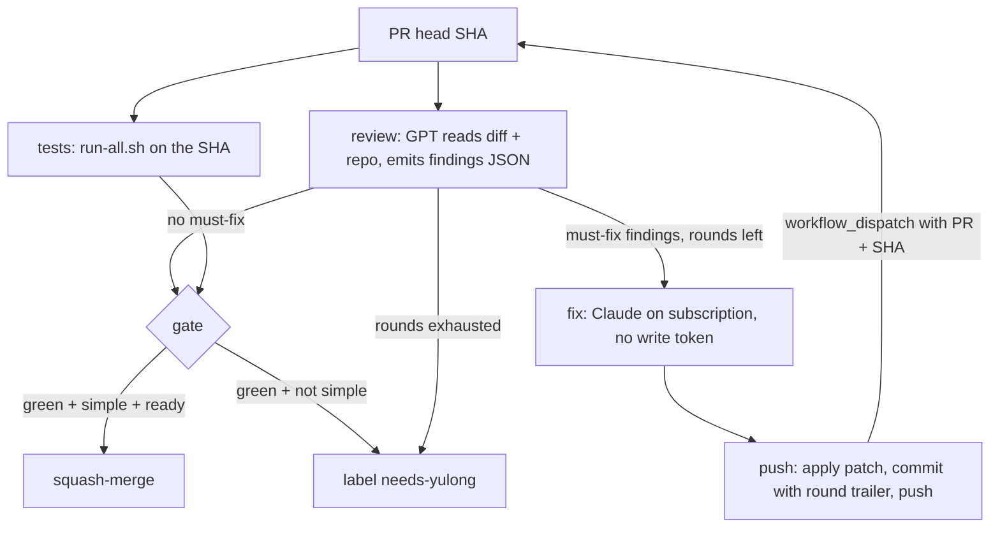

# One Actions loop gates every PR

Spec for the dotfiles PR loop: GPT reviews, Claude fixes on the subscription, simple changes merge themselves. Replaces the local blocking gate in [PR 207](https://github.com/yulonglin/dotfiles/pull/207). Drafted by Claude Opus 5.5, 12 Oct 2026. Status: **awaiting Yulong's review; nothing beyond the auth probe is built.**

## Overview

Today a PR in this repo is reviewed only when a session remembers to review it, and merged when a session decides it is simple. The green checks on a PR do not run the regression suites: the six workflows name 15 test files between them, most behind a path filter, while `tests/run-all.sh --list` discovers 121 suites that otherwise run only by hand. [PR 207](https://github.com/yulonglin/dotfiles/pull/207) tried to close the review gap with a local hook, and the held-PR review of 3 Oct (GPT-6 Astra, 97%; brief at `/Users/yulong/vault/tooling/dotfiles/held-prs-brief-2026-10-03.md`) found it gates on the review skill being *invoked*, not on the review *passing*, its markers outlive later edits, config-only changes skip it, and the automatic PR creator sits outside it.

This spec moves the gate to GitHub Actions, where it binds to a commit SHA and cannot be skipped by a session:

- the top GPT model reviews each PR head and posts its findings;
- a Claude Code run, authenticated by Yulong's subscription, fixes the findings and pushes;
- every new head is reviewed again, up to a fixed number of rounds;
- the regression suites run on every head;
- a PR that is approved, green and simple merges itself; anything touching hooks, settings, secrets or the loop itself waits for Yulong.

[PR 191](https://github.com/yulonglin/dotfiles/pull/191) (advisor Stop hook) stays a local, advisory nudge and is not part of this gate. Main's non-blocking simplify nudge also stays. PR 207 is closed with a pointer here once this spec is agreed.

## Requirements

### Subscription auth is proven before anything else is built

- MUST: `.github/workflows/claude-auth-probe.yml` (on this branch) shows Claude Code answering headless on a GitHub-hosted runner with only `CLAUDE_CODE_OAUTH_TOKEN` set, the long-lived token `claude setup-token` mints ([docs](https://code.claude.com/docs/en/authentication#generate-a-long-lived-token)). It lasts one year and can only make model requests.
- MUST: the probe refuses to call the model while `ANTHROPIC_API_KEY`, `ANTHROPIC_AUTH_TOKEN` or a cloud-provider switch is set, because all of them outrank the OAuth token and `-p` mode uses an API key without asking ([precedence](https://code.claude.com/docs/en/authentication#authentication-precedence)). It then asserts the CLI's own `apiKeySource` is not an API key; locally under `/login` that field reads `none` (measured 12 Oct).
- MUST: a second leg grants only `Write` under `acceptEdits` and checks the file lands, since the fixer needs headless edits.
- MUST: a run with the secret missing fails at the precheck with a named reason, not at the model call.
- `--bare` is never used: bare mode does not read `CLAUDE_CODE_OAUTH_TOKEN`.

### The regression suites run on every PR head

- MUST: a new `tests.yml` runs `tests/run-all.sh` on `ubuntu-latest` for every `pull_request`, every push to `main`, and as a `workflow_call` the loop invokes on fixer-pushed SHAs. `run-all.sh` already separates SKIP (exit 77, missing interpreter, all-skipped pytest, `SKIP_WHEN`) from FAIL, so suites that need macOS, a tailnet or a live router report SKIP, not red.
- MUST: before it becomes required, one measurement run lists every suite that FAILs on the runner. Each is fixed, given an exit-77 guard, or added to `SKIP_WHEN` with the reason, in that PR. `always-on-guards.yml` refused to be a suite runner because "a workflow that is red for environmental reasons teaches people to ignore it"; this step is what answers that.
- SHOULD: a weekly `macos-latest` run of the same suite (free on a public repo) catches the macOS-only suites the Linux job skips. It is not part of the gate.
- The existing six workflows stay as they are; they run named guards that must not go quiet on their own path filters.

### GPT reviews each head and posts typed findings

- MUST: the review job runs `codex exec` (npm `@openai/codex`, pinned to a version past the 7-day release age) in `--sandbox read-only` against a checkout of the PR head, with the base diff as the prompt and `--output-schema` forcing `{verdict, findings: [{severity, file, line, summary, failure_scenario}]}`.
- MUST: `severity` is one of `must-fix`, `should-fix`, `nit`. **must-fix** uses the bar in `claude/rules/coding-conventions.md`: it changes a real output (a label, a number, what a user or monitor sees) or is a real security risk, shown concretely. A constructed attack is a follow-up, not a must-fix.
- MUST: the model is the top GPT model the OpenAI API serves at build time. Lean: `gpt-6.1-sol`. The router config records `gpt-6-astra` and `gpt-5.6-sol` in the public `/v1/models` catalogue; whether the API (not the ChatGPT account) serves `gpt-6.1-sol` is **unverified** and is checked at build.
- MUST: the job posts one review comment per head SHA, edited in place if rerun, and uploads the findings JSON as a run artifact the fix job reads.
- MUST: the review job holds `OPENAI_API_KEY` and no other secret.

### The fixer never holds a write token

- MUST: the fix job runs only when the review has at least one `must-fix` or `should-fix` finding and rounds remain. It runs `claude -p` with `CLAUDE_CODE_OAUTH_TOKEN`, a checkout with `persist-credentials: false`, and `permissions: contents: read`. Its input is the findings JSON plus Yulong's unresolved review comments on the PR.
- MUST: tools are an allowlist: `Read`, `Edit`, `Write`, `Glob`, `Grep`, and `Bash` limited to the test commands (`tests/run-all.sh`, `python -m pytest`, `bash tests/…`) and read-only git. No network tools. `--max-turns` and a job timeout bound it.
- MUST: the fixer's output is a patch uploaded as an artifact. A separate push job, which holds `contents: write` and no Claude token, rejects the patch if it touches a protected path (below), then commits it with a `PR-Loop-Round: N` trailer and pushes. The Claude token and the write token never share a job, so text in a PR or a finding that steers the fixer cannot reach the push credential.
- GitHub refuses a `GITHUB_TOKEN` push that changes `.github/workflows/`, because that token has no `workflows` permission. That is a second, independent stop on the loop editing itself (~90% confident from memory, not re-read in the docs; phase 4 tests it).

### Every changed commit is reviewed again, a bounded number of times

- MUST: a push made with `GITHUB_TOKEN` does not start a normal `pull_request` run; `synchronize` from that token lands in an approval-required state, and only `workflow_dispatch` and `repository_dispatch` always run ([GitHub docs](https://docs.github.com/en/actions/concepts/security/github_token)). So the push job dispatches `pr-loop.yml` with inputs `pr` and `sha`. The dispatched run validates both (`^[0-9]+$`, 40 hex) and exits as stale if the PR head is no longer that SHA.
- MUST: the round count is the number of `PR-Loop-Round` trailers between the merge base and the head, so it survives dispatch and reruns with no stored state. **Cap: 2 fix rounds** (variable `MAX_ROUNDS`), so at most 3 reviews per chain of fixer commits. A human push starts a fresh chain.
- MUST: when the cap is reached with must-fix findings still open, the PR gets the `needs-yulong` label and a comment listing what is open. No further fix runs.
- MUST: one loop per PR at a time (`concurrency: pr-loop-<number>`, cancel in progress), so a human push supersedes a running fix.

### One status on the head SHA is the gate

- MUST: the loop sets a commit status `pr-loop/gate` on the head SHA: `pending` when the run starts, so a new head is never green by absence; `success` only when the tests pass on that SHA and the review of that same SHA has no must-fix finding; `failure` otherwise, with the reason in the description.
- MUST (pending decision 1): a repository ruleset on `main` requires `pr-loop/gate` for pull requests, with Yulong as bypass actor, so direct pushes to `main` keep working as `CLAUDE.md` allows. The branch is unprotected today and `allow_auto_merge` is off.

### Only simple, ready, approved PRs merge themselves

- MUST: a PR auto-merges (squash, branch deleted) only when all hold: gate `success` on the head; not a draft (pending decision 2); no `hold` label; and the change is **simple**.
- MUST: **simple** means touching no protected path, and either every changed file is Markdown or exactly one non-Markdown file changed. This follows the existing rule for self-merge in `coding-conventions.md` ("docs, rules, one file, tests green, nothing under settings, hooks or secrets").
- MUST: **protected paths** always go to Yulong: `claude/hooks/**`, `claude/settings.json`, `.claude/**`, `.github/**`, `config/git-hooks/**`, `config/model-router.toml`, `custom_bins/dotfiles-secrets`, `custom_bins/model-router-wire`, any `.envrc`, any path containing `secret`, and `tools/claude-tools/**`. The last is protected for a different reason: a merge made with `GITHUB_TOKEN` does not fire `push` workflows on `main`, and the claude-tools release job runs only on push.
- MUST: a green PR that is not simple gets `needs-yulong` and a one-line comment naming the protected path or the size reason.

### Spend is capped outside the workflow and measured inside it

- MUST: the reviewer's `OPENAI_API_KEY` belongs to a dedicated OpenAI project with a monthly budget limit Yulong sets (pending decision 3). The fixer spends subscription usage, not API money.
- MUST: each review run writes its input and output token counts to the job summary, so the real cost per review comes from the phase-2 runs, not a guess. No cost estimate is given here because the per-token price of the chosen model is not verified.
- The per-PR ceiling is structural: 1 + `MAX_ROUNDS` reviews per chain.

### Only Yulong's own same-repo PRs enter the loop

- MUST: every job runs only when `head.repo.full_name == github.repository` and the PR author is `yulonglin`. GitHub already withholds secrets from fork PRs on a public repo; this also keeps a third-party PR from spending either budget.
- MUST: triggers are `pull_request` and `workflow_dispatch`, never `pull_request_target`.
- MUST: no PR-controlled string (title, body, branch name, comment) is interpolated into a `run:` line; each goes through `env:`.
- MUST: no third-party actions; CLIs come from npm at pinned versions (pending decision 4).

### Rollout ships one phase at a time

1. **Auth probe** — this branch. Blocked on the secret (below).
2. **Suites in CI** — `tests.yml`, the measurement run, the fixes or skips it calls for. No secrets, no spend. Not yet required.
3. **Reviewer, advisory** — review comments on every PR, no fixer, no gate. Measures cost per review and how often a must-fix is wrong.
4. **Fixer and loop** — fix, push, dispatch, round cap, on PRs labelled `pr-loop` only.
5. **Gate and auto-merge** — the status, the ruleset, auto-merge for simple PRs, the loop on every PR. PR 207 closes at the latest here.

Each phase is its own PR and needs Yulong's go before the next starts, because phases 3–5 spend money or change what merges.

## Acceptance Criteria

### Phase 1 passes when the probe is green on a hosted runner

- A run of `claude-auth-probe.yml` on `ubuntu-latest` shows both legs passed, with `apiKeySource` printed and not an API key.
- A run with the secret absent fails at the precheck step with the named error (the run already pushed with this branch is that negative control).

### Phase 2 passes when the suites are green or skipped for a stated reason

- `tests.yml` on a PR head prints PASS / SKIP / FAIL per suite, and every SKIP names its reason.
- No FAIL on the PR that lands it; each suite that failed in the measurement run is listed in the PR body with what was done about it.
- A deliberately broken suite on a throwaway branch turns the job red (the job can fail).

### Phase 3 passes when reviews land on real PRs

- On at least three real PRs, a review comment appears per head SHA with schema-valid findings, and the job summary shows token counts.
- Yulong has read the must-fix findings on those PRs and judged how many were wrong; that rate decides whether phase 4 starts.

### Phase 4 passes when the loop converges or escalates

- On a throwaway PR seeded with one real must-fix defect, the fixer pushes a commit with `PR-Loop-Round: 1`, a dispatched run reviews the new SHA, and the gate goes green.
- On a throwaway PR seeded with a defect the fixer cannot fix within the cap, the PR stops at round 2 with `needs-yulong` and no third fix run.
- A fixer patch touching `claude/settings.json` is rejected by the push job, and the PR is labelled.
- No job in the run log holds both `CLAUDE_CODE_OAUTH_TOKEN` and a write-scoped token.

### Phase 5 passes when merges follow the simple rule

- A Markdown-only PR that is green and ready merges itself; the same PR as a draft does not.
- A green PR touching `claude/hooks/` is labelled `needs-yulong` and stays open.
- A direct push to `main` by Yulong still succeeds with the ruleset active.
- PR 207 is closed with a comment linking this spec.

## Decisions waiting on Yulong {judgement}

1. **Ruleset.** Lean: require `pr-loop/gate` on PRs to `main` with Yulong as bypass actor, so the loop is the merge gate and direct pushes still work. Alternative: no ruleset; the gate is a status Yulong reads and only auto-merge obeys it.
2. **Merge signal.** Lean: auto-merge only a PR marked ready for review, because `pr_after_push` opens every PR as a draft and an agent's WIP push should never merge. Alternative: an `automerge` label.
3. **Reviewer auth.** Lean: an OpenAI API key in a dedicated project with a monthly budget limit. OpenAI's Codex docs call API keys "the recommended default for automation", and the ChatGPT-account route needs the refreshed `auth.json` persisted between jobs ([Codex auth](https://learn.chatgpt.com/docs/auth)). That route spends no API money but is fragile and stores a refreshable account token on a public repo's runners.
4. **Actions posture.** Lean: keep "first-party actions only" and install both CLIs from npm at pinned versions. Alternative: `anthropics/claude-code-action`, which brings inline-comment tooling but is the first third-party action in this repo.
5. **Round cap.** Lean: `MAX_ROUNDS = 2`.
6. **Protected paths.** The list above; add or remove entries.
