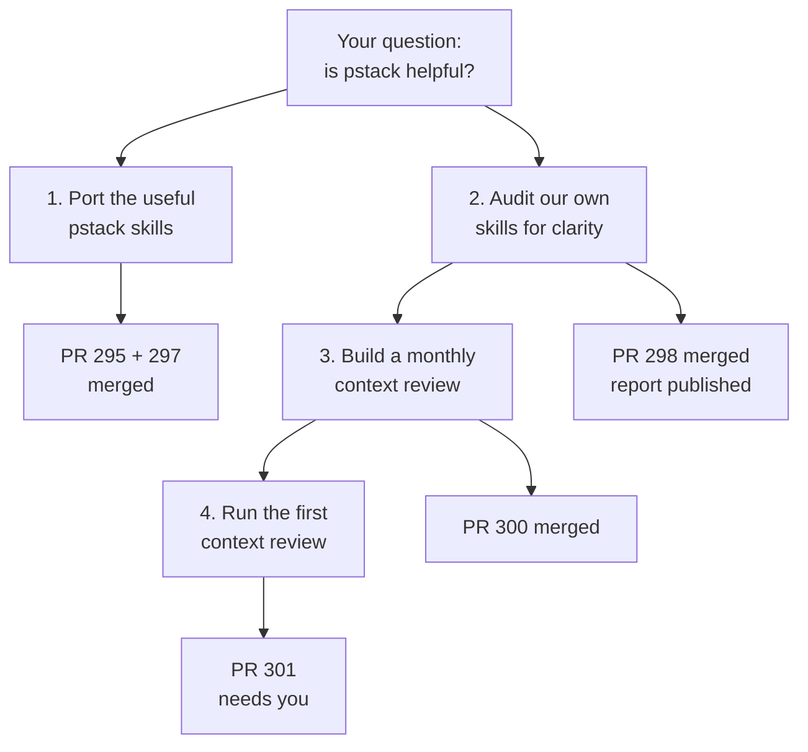
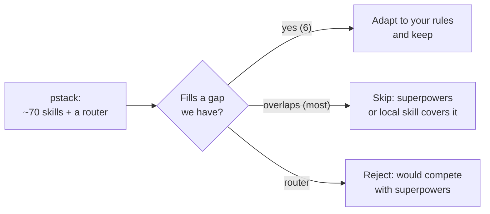
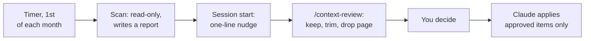

# Session Map, 3–4 November

**You asked one question, "would pstack be helpful?", and it grew into four pieces of work.** Three are merged. One waits on you, together with seven smaller calls. This page shows each piece as problem, goal, options and approach, so you can check the reasoning, not only the result.

Written by Claude Opus 5.5 on 4 Nov 2026. Each "needs you" item has a control; set it, or comment on the line.

## The whole session on one page

How each step led to the next: porting showed that pstack is clearer than many of your LLM-written skills, which you asked about. The clarity audit then showed the always-on byte budget had just been dropped, which led to your question about periodic pruning. That gap became the monthly context review, and its first run is item 4.

## 1. Porting pstack: take the parts, not the system

| | |
|---|---|
| **Problem** | You heard of pstack (Lauren Tan's skill stack), kun and ahoy, and wanted to know if they help. |
| **Goal** | Gain what they do well without a second system fighting superpowers for control. |
| **Options considered** | Install pstack whole; install nothing; copy single skills and adapt them. |
| **Approach chosen** | Copy six skills that fill real gaps, adapted to your rules. Reject kun (it runs unpinned remote code) and ahoy (it only works inside firstmate). |
| **Checked by** | GPT-6 Astra and Gemini 4 Argon reviews, which found 8 real defects, all fixed. |
| **Status** | Merged: `blast-radius`, `babysit-pr`, `correct`, `catch-me-up` (PR 295); `why`, `sharpen` (PR 297). |

## 2. Clarity audit: contradictions, not length

| | |
|---|---|
| **Problem** | You said many of your skills, agents and rules were LLM-written and some are unclear. |
| **Goal** | Find where an agent reading cold would take the wrong path, and what to fix first. |
| **Options considered** | Shorten everything; rewrite in pstack's style; find and fix contradictions first. |
| **Approach chosen** | Two other model families audited separately (GPT-6.1 Sol for skills, GPT-6 Astra for agents and rules), using pstack as the yardstick; I re-read every cited line I marked verified. |
| **Finding** | The problem is two instructions that disagree, and permission checks placed after the action. Six contradictions are confirmed. |
| **Status** | [Report](https://claude.ai/artifact/1DJKqZ61u1Dp88fxvBk1gP) published, with a fix / skip / discuss control on each item; **none applied yet**. One bug found on the way was fixed: `md2artifact` never declared the downloads capability. |

## 3. Monthly context review: the missing periodic check

| | |
|---|---|
| **Problem** | Nothing periodic measured context cost or pruned memory, and the only size guard (the byte ceiling) was removed on 3 Nov. |
| **Goal** | A monthly look at what loads every session and what has gone stale, with you deciding what goes. |
| **Options considered** | Timer plus nudge; nudge only; one manual review; nothing. **You chose timer plus nudge.** |
| **Approach chosen** | Copy the council-roster pattern: a read-only scan on a monthly timer, a one-line nudge at session start, and a skill that turns the report into keep / trim / drop. Nothing is deleted without you. |
| **Checked by** | Sol review found that slash commands were miscounted as unused (61 became 49 after the fix); 17 tests pass. |
| **Status** | Merged (PR 300). The timer is **not installed** until `deploy.sh` runs. |

## 4. First context review: most "unused" items stay

| | |
|---|---|
| **Problem** | The scan listed 49 skills and agents with no use in 90 days on this server. |
| **Goal** | Separate real waste from things that only look unused. |
| **Approach chosen** | Check each item for three blind spots: Mac-only use, a rule that routes to it, and a plugin that cannot be split. |
| **Your decisions** | Switch off two unused agents (`sol6`, `gpt-5.6-sol(high)`); archive the duplicate local `strategic-communication`; keep Effortful Learning; keep `learn-quiz` and `application-writer`, but find when they help. |
| **Status** | Applied on a branch and committed; **the push to GitHub is failing** with a server error (PR 301). |

## What needs you

### Merge and deploy

- [ ] **Merge PR 301, then run `model-router-wire apply`.** PR 301 holds the review page and your three approved changes. The `apply` step rewrites the generated agent files and the live router config, so it runs from your main checkout after the merge, not from my branch. If the push still fails when you read this, the commit is safe on branch `context-review-2026-11-03` in `/home/yulong/code/dotfiles/.claude/worktrees/pstack-port`.
- [ ] **Run `deploy.sh` once to install the monthly timer.** Until then the review only runs when asked.
- [ ] **Pull `main` into your main checkout.** When this session started it was at `35efa921`, and `origin/main` is now 75 commits ahead of that (25 merged PRs, six of them from this session). Until it is pulled, the new skills and the context-review nudge do not load, because `~/.claude` points at that checkout. The sandbox blocks `git pull` here.

### Decide

- [ ] **Hookify: keep or drop?** See "Hookify: what it is for" below. Lean: drop.
- [ ] **Document authority** (from the clarity audit): one editable source, or immutable published copies? Lean: one editable source.
- [ ] **Clarity-audit fixes: start with the six verified contradictions?** Lean: yes, as one PR, reviewed by another model family.
- [ ] **Adopt the visibility changes proposed at the end of this page?**

## Hookify: what it is for

Hookify turns a correction into a guard without writing hook code. You say `/hookify Warn me when Claude runs rm -rf`, and it writes a small Markdown file holding a regular expression and a message; from the next tool call, a match shows the warning or blocks the call. Run with no arguments, it reads the conversation for things you corrected and proposes rules.

**When it works well:** a quick guard on a pattern you can describe as text (a command, a file path, a word in a file), in a project where nobody wants to write and test a hook script.

**Why it is a weak fit here:**

- You already have about 80 hand-written hooks in `claude/hooks/`, many with tests, and a pipeline that knows how to add more.
- Its rule files are named `.claude/hookify.*.local.md`, so git ignores them and they do not travel between your machines. Your saved preference is version-controlled files, never `.local.md`.
- It matches regular expressions only, so it cannot express "a hook that refuses unless a test exists", which is what most of your hooks do.
- The new `correct` skill does the same job one level up: it finds a mistake that repeats and makes it impossible, choosing between architecture, a type, a hook and a test.

Lean: drop it, and use `correct` when a correction repeats. About 214 tokens per session come back.

## When `learn-quiz` and `application-writer` help

- **`learn-quiz`** teaches and then quizzes you until you understand something: a codebase, a diff, a concept, or **this session's work**. That is the tool for the feeling of being out of the loop after a long unattended run. Today nothing points to it, which is why it was never used. Proposal: `catch-me-up` and `debrief` end by offering it in one line when the session ran unattended.
- **`application-writer`** drafts job and fellowship applications within word limits, from your past applications, references and CV. It fires on its own when you ask for an application. The clarity audit found that its built-in examples state results as facts and give wrong word counts, so fix those before relying on it.

## Proposal: how I keep you in the loop from now on

You said you still feel out of the loop, without enough visibility, choice or control. Three changes would address that. Each is small, and none is applied yet.

1. **Start long work with one diagram.** Before work that will run more than a few steps, I show one diagram of problem, goal, options and the approach I lean towards, and ask before going further when the choice is yours. Today that happened only for the context-review timer.
2. **End long work with a map like this one,** not a list of PR numbers. `catch-me-up` and `debrief` would draw it.
3. **Offer `learn-quiz` after unattended work,** so understanding the work is one command away.

To make this durable, it becomes one sentence in `claude/rules/communication.md` (about 300 bytes in every session): *"Work past a few steps opens with one diagram of the problem, goal, options and lean, and closes with a map of what changed and what waits on Yulong."* Plus a line in each of `catch-me-up` and `debrief`.
